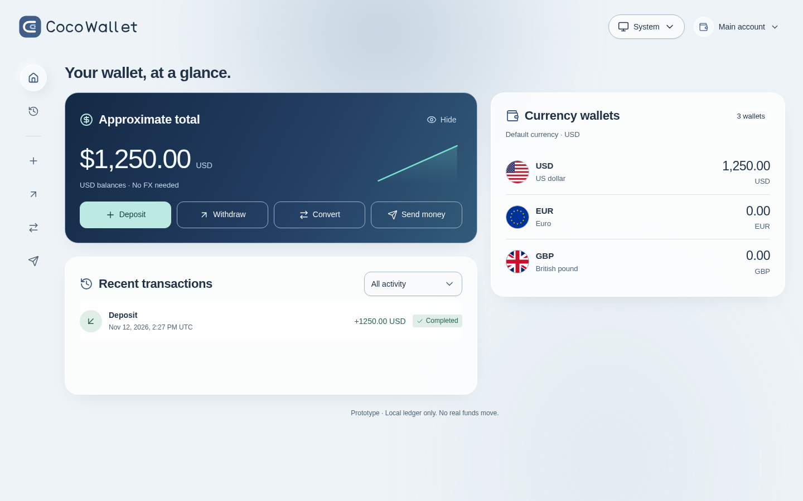

<div align="center">
  <picture>
    <source media="(prefers-color-scheme: dark)" srcset="public/brand/cocowallet-logo-inverse.svg" />
    
  </picture>

**A local multi-currency wallet, built for exploration.**

Simulate deposits, withdrawals, conversions, and transfers—then follow the results through an exact, journal-backed ledger.


[Quick start](#quick-start) · [Features](#features) · [Tech stack](#tech-stack) · [User guide](artifact/USER_GUIDE.md) · [Interactive guide](artifact/index.html)
</div>

---

> **CocoWallet is a simulation, not a financial service.** No real funds move. Provider names and destination accounts are simulated; there is no banking, blockchain, payment, or authentication integration. Run it locally and do not expose it publicly.

<div align="center">
  
  <br />
  <sub>Overview captured with Playwright using a disposable example database.</sub>
</div>

## Features

- **Multi-currency overview** — inspect individual wallets, an approximate USD total, recorded balance history, and recent activity.
- **Simulated funding** — review and confirm deposits and withdrawals using fictional provider labels.
- **Currency conversion** — review server-owned, expiring quotes based on Frankfurter reference rates before confirming.
- **Transfers** — send simulated funds to saved or new destinations; inspect destination accounts in read-only mode.
- **Transaction history** — browse completed transactions, filter by type, currency, and UTC date, search by exact ID, and inspect recorded facts.
- **Exact accounting** — balances come from immutable journal entries, with decimal input validation, atomic operations, and original-request retry protection.
- **A considered interface** — light and dark themes, privacy controls, responsive navigation, and keyboard-accessible controls.

> Reference rates are not streaming market prices. If a required rate is unavailable, the app reports an unavailable total or blocks the affected quote instead of inventing a value.

## Quick start

**Requirements:** Docker Engine and Docker Compose. Node does not need to be installed on your host; the container supplies Node 26.

```sh
git clone https://github.com/ahmadhafizh16/cocowallet.git
cd cocowallet

docker compose build app
docker compose run --rm app npm ci
docker compose run --rm app npm run db:migrate
docker compose run --rm app npm run db:seed
docker compose up -d app
```

Open **[http://localhost:3000](http://localhost:3000)**. The health endpoint is at `/api/health`, and `/api/ready` checks the SQLite connection and migrated metadata table.

The seed creates a main account and USD, EUR, and GBP wallets with **zero balances**; it does not create funds or transaction history. To use another port, run `APP_PORT=3100 docker compose up -d app` and open `http://localhost:3100`.

### Learn your way around

Open **[`artifact/index.html`](artifact/index.html)** in a browser after cloning the repository for the interactive, screenshot-led guide, searchable file tree, and test catalogue. It works directly from disk; GitHub itself displays the HTML source rather than running it.

Prefer reading on GitHub? Start with the [Markdown user guide](artifact/USER_GUIDE.md). It covers account switching, the balance-history chart, money workflows, transaction history, and recovery.

## Tech stack

| Layer           | Technology                                               |
| --------------- | -------------------------------------------------------- |
| Application     | Next.js 16 App Router, React 19, TypeScript 5.9          |
| Runtime         | Node.js 26, npm 11, Docker Compose                       |
| Data and ledger | SQLite, `better-sqlite3`, Drizzle ORM and SQL migrations |
| Interface       | Tailwind CSS 4, shadcn/ui, Radix UI, Lucide              |
| Reference rates | Frankfurter, with a bounded eligible cache fallback      |
| Tests           | Jest and Playwright / Chromium                           |

Versions and scripts are pinned in [`package.json`](package.json) and [`package-lock.json`](package-lock.json).

## Project map

```text
src/app/         Next.js pages, layouts, and API routes
src/features/    Wallet, accounting, rates, history, and other feature modules
src/server/      SQLite, HTTP contracts, and server-side integration
src/components/  Shared interface primitives and CocoWallet branding
drizzle/         Reviewed SQLite migrations and schema metadata
e2e/             Playwright browser and API scenarios
artifact/        Interactive guide, user manual, requirements, and decisions
```

Explore the full annotated tree in the [interactive guide](artifact/index.html#files) or [`artifact/PROJECT_STRUCTURE.md`](artifact/PROJECT_STRUCTURE.md).

## Verification

```sh
docker compose run --rm app npm run artifacts:check
docker compose run --rm app npm run lint
docker compose run --rm app npm run format:check
docker compose run --rm app npm run typecheck
docker compose run --rm app npm test
docker compose --profile test build browser-tests
docker compose --profile test run --rm browser-tests
```

Read-only browser checks can use the normal local app. **Monetary and quote browser tests require the guarded disposable server** described in [`artifact/QUOTES.md`](artifact/QUOTES.md); they must never fund or seed quotes into the persistent wallet. The test catalogue is available in [`artifact/TEST_CASES.md`](artifact/TEST_CASES.md).

For the complete check, including a production build, stop the development service first so two compilers do not write to the same Next.js output volume:

```sh
docker compose stop app
docker compose run --rm app npm run check
docker compose up -d app
```

## Data and safety

- SQLite data lives in the Docker `wallet-data` named volume. Use `docker compose down` for normal shutdown, **without `--volumes`**; deleting that volume destroys simulated balances and history.
- Migrations and seeding are explicit. Back up an existing database before applying new migrations; never use a volume reset as a substitute for a reviewed migration.
- Review does not submit an operation. A confirmed result requires a server response. If the outcome is uncertain, recover the **original request** rather than starting a replacement; unresolved context uses per-tab session storage and can be lost if the tab or its storage is cleared.
- The app binds its host port to `127.0.0.1` and has no authentication. Do not expose it to a public network.

## API and further reading

The local API includes account and wallet reads, deposits, withdrawals, conversions, transfers, reference rates, quotes, portfolio valuation, and transaction history. The OpenAPI document is available at `/api/openapi`; Swagger UI is not currently implemented. Money submissions require UUID retry keys, and identical retries replay their original definitive result.

- [Documentation and project decisions](artifact/README.md)
- [Money and journal contracts](artifact/MONEY.md) · [Journal implementation](artifact/JOURNAL.md)
- [Funding](artifact/FUNDING.md) · [Conversions](artifact/CONVERSIONS.md) · [Transfers](artifact/TRANSFERS.md) · [History](artifact/HISTORY.md)
- [Design system](DESIGN.md) · [Design tooling](artifact/TOOLING.md)
