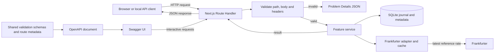

# HTTP API design: draft

**Status:** Account/wallet reads, simulated funding POSTs, fresh-first reference metadata and immutable one-minute quotes are implemented under D-029–D-032, with maintained OpenAPI contracts. Conversion/transfer submission, history contracts, generation and Swagger UI remain future work. See [FUNDING.md](FUNDING.md), [RATES.md](RATES.md) and [QUOTES.md](QUOTES.md).

## Implemented operational endpoints

| Method | Route | Result |
| --- | --- | --- |
| GET | `/` | Dynamic stored-account/journal overview with reviewed simulated funding and partial completed-funding visibility. |
| GET | `/api/health` | 200 JSON liveness response with `Cache-Control: no-store`. |
| GET | `/api/ready` | 200 JSON when the migrated metadata table is readable; otherwise 503 Problem Details with `DATABASE_NOT_READY`. |
| GET | `/api/accounts` | Persistent main account and destinations; role/default/creation time/inspect-only metadata. |
| GET | `/api/accounts/{accountId}/wallets` | One account and its snapshot-consistent exact balances as decimal minor-unit strings. |
| GET | `/api/openapi` | OpenAPI 3.1 document for implemented routes, including reference metadata and quotes; not Swagger UI. |
| POST | `/api/deposits` | Explicit simulated deposit; required UUID key and durable original-result replay. |
| POST | `/api/withdrawals` | Explicit simulated withdrawal; protected debit and durable error/success replay. |
| GET | `/api/currencies` | Fresh-first eligible fiat list with pinned precision, original fetch time and eligible cached fallback. |
| GET | `/api/rates?base=USD&quote=EUR` | Exact direct reference observation with source/fetch dates and fresh/cached provenance; not a binding quote. |
| POST | `/api/quotes` | Persist immutable conversion/cross-currency transfer preview terms; no funds reservation or money idempotency key. |
| GET | `/api/quotes/{quoteId}` | Read immutable terms and active/expired/consumed state without refreshing the rate or expiry. |

Routes are in `src/app/`; Jest tests verify isolated database reads, safe errors and read-response/spec agreement. Wallet GETs never seed or mutate storage and return `Cache-Control: no-store`. Missing initialization/storage is 503, unknown account is 404, empty/null-character path ID is 400. Read codes are `ACCOUNT_NOT_INITIALIZED`, `WALLET_DATA_UNAVAILABLE`, `ACCOUNT_NOT_FOUND` and `INVALID_ACCOUNT_ID`; all use safe Problem Details. Unsupported methods retain Next.js's 405 with no mutation/body contract. See [the fixed read shapes](BACKEND_READS.md).

Reference GETs may update only technical caches. Every request tries fresh data
before fallback, which must be validated and less than 24 hours old. Exact-pair
coverage is checked by the actual CSV row, never inferred from currency listing.
Invalid query/codes are 400; unavailable metadata/storage is safe 503; all
responses remain no-store. See [the reference contract](RATES.md). No FX GET can
confirm a quote, alter a wallet or authorize a money-moving operation.

The [fixed quote contract](QUOTES.md) binds exact original input and recipient
context, records exact source/target amounts and provenance, and starts a full
60-second hold after final validation. Cache eligibility is checked at issuance;
crossing its 24-hour boundary later does not shorten the issued hold. No preview
creates a recipient/wallet or moves money. Internal confirmation/consumption seams
are ready for later services, but no conversion/transfer HTTP submission exists.

The [interface](UI_FOUNDATION.md) now reads stored balances but validates/reviews
money drafts locally. Deposit/withdrawal confirmations now use the fixed funding
contract in [IDEMPOTENCY.md](IDEMPOTENCY.md); conversion/transfer final actions
remain disabled. Operational readiness does not imply accounts have been seeded.

**Decision references:** [D-003](DECISIONS.md#d-003), [D-007](DECISIONS.md#d-007), [D-008](DECISIONS.md#d-008), [D-010](DECISIONS.md#d-010), [D-017](DECISIONS.md#d-017), [D-018](DECISIONS.md#d-018), and [D-019](DECISIONS.md#d-019). Detailed requirements and tasks: [PRD-10](prd/PRD-10-api.md) and [Tasks 10](tasks/TASKS-10.md).

## Agreed direction

- Use Next.js App Router Route Handlers, an OpenAPI specification, and Swagger UI.
- Reuse validation schemas for documentation where practical, and test that the published specification and implemented behavior remain aligned. The generator is not selected yet.
- Document baseline errors as Problem Details: 400 invalid request, 404 missing resource, 409 balance/quote/idempotency conflict, and 503 when no eligible exchange rate is available.
- Run locally without application authentication. The HTTP API and Swagger UI can change simulated data, so bind the host-facing development port to localhost unless access requirements are deliberately changed.
- Expose existing wallet operations, not real payment or banking integrations. Destination accounts are inspect-only; enforce that in server-side services as well as in the UI.

## Candidate endpoint groups

| Method | Example route | Purpose |
| --- | --- | --- |
| POST | `/api/wallets` | Add a supported fiat wallet to the main account. |
| PATCH | `/api/accounts/{accountId}/default-currency` | Change the main account's default currency; destinations are read-only. |
| POST | `/api/conversions` | Confirm a conversion, creating the target wallet if required. |
| POST | `/api/transfers` | Transfer to an existing or newly created simulated account. |
| GET | `/api/transactions` | List/filter an account's transactions. |
| GET | `/api/transactions/{transactionId}` | Inspect an individual transaction. |

These remaining examples are not finalized write/history contracts. The two
account GETs and quote routes above are implemented; decide default updates,
pagination and remaining resource names before implementing their routes.

## Funding request/response contract

The implemented funding contract, exact pre-acceptance/recorded error distinction,
immutable original receipt, UUID scope and recovery semantics are authoritative in
[IDEMPOTENCY.md](IDEMPOTENCY.md) and [FUNDING.md](FUNDING.md). Both endpoints use
HTTP 200 on completion, 400/404/409 Problem Details for known rejections, and
nondefinitive 503 for unknown storage outcomes. JSON fields are `walletId`,
`amount`, `provider`; all amounts remain strings. The earlier illustrative
funding examples below are superseded by those fixed contracts and OpenAPI.

## Remaining proposed request/response contract

The names, fields, example IDs, successful response statuses, and payloads in this section are **illustrative proposals**, not an existing or finalized API. The error baseline and idempotency requirements are the agreed [D-017](DECISIONS.md#d-017)/[D-019](DECISIONS.md#d-019). Each route must be reflected in the generated OpenAPI document and tested against its actual implementation.

| Operation | Candidate input | Candidate successful result | Relevant decisions |
| --- | --- | --- | --- |
| List accounts | No body | Account IDs, default currencies, main/destination designation, and inspect-only indication | [D-003](DECISIONS.md#d-003), [D-004](DECISIONS.md#d-004) |
| Inspect wallets | `accountId` path parameter | Wallet IDs, fiat codes, exact balances, and any applicable USD-total/unavailable indication | [D-003](DECISIONS.md#d-003), [D-011](DECISIONS.md#d-011), [O-004](DECISIONS.md#o-004) |
| Add wallet | Main `accountId` and supported fiat code | Created wallet ID and zero journal-derived balance | [D-004](DECISIONS.md#d-004), [D-018](DECISIONS.md#d-018) |
| Change main default | Main `accountId` plus fiat code | Updated default; missing-wallet behavior remains open | [D-004](DECISIONS.md#d-004), [O-004](DECISIONS.md#o-004) |
| List currencies | Implemented GET; no body | Exact contract superseded by [RATES.md](RATES.md), including D-031 fresh-first fallback | [D-004](DECISIONS.md#d-004), [D-031](DECISIONS.md#d-031) |
| Deposit / withdrawal | Main wallet ID, decimal-string amount, fictional provider, `Idempotency-Key` | Completed transaction and affected balance | [D-005](DECISIONS.md#d-005), [D-006](DECISIONS.md#d-006), [D-019](DECISIONS.md#d-019) |
| FX quote | Implemented POST/GET; exact fields in [QUOTES.md](QUOTES.md) supersede this proposal | Immutable terms and lifecycle state; no funds reservation | [D-032](DECISIONS.md#d-032) |
| Convert | Server quote reference and `Idempotency-Key` | One completed conversion, debit/credit amounts, and retained rate metadata | [D-009](DECISIONS.md#d-009), [D-018](DECISIONS.md#d-018), [D-019](DECISIONS.md#d-019) |
| Transfer | Source wallet, destination account ID, amount, target/default-currency information, quote reference when FX is needed, and `Idempotency-Key` | One completed transfer and destination identity; the credited wallet/account is created when needed | [D-010](DECISIONS.md#d-010), [D-018](DECISIONS.md#d-018), [D-019](DECISIONS.md#d-019) |
| Transaction list | Account ID and optional type, currency, date filters | Completed records, newest first; pagination is open | [D-012](DECISIONS.md#d-012), [O-003](DECISIONS.md#o-003) |
| Transaction detail | Transaction ID and, if needed, inspected account context | Stored operation details, including provider/destination and historical rate as applicable | [D-012](DECISIONS.md#d-012), [O-003](DECISIONS.md#o-003) |

Illustrative deposit request; the provider code and path are proposals:

```http
POST /api/deposits
Content-Type: application/json
Idempotency-Key: example-request-001

{
  "walletId": "example-usd-wallet",
  "amount": "100.00",
  "provider": "DEMO_BANK"
}
```

Historical illustrative FX preview, **superseded** by [QUOTES.md](QUOTES.md)
and the implemented OpenAPI schemas; not a current response shape:

```json
{
  "quoteId": "example-quote",
  "source": { "amount": "100.00", "currency": "USD" },
  "target": { "amount": "80.00", "currency": "GBP" },
  "rate": "0.8",
  "rateDate": "2026-11-10",
  "fetchedAt": "2026-11-11T10:00:00Z",
  "cached": false,
  "expiresAt": "2026-11-11T10:01:00Z"
}
```

The server must bind the quote to the operation and verify it at confirmation; the client must not be able to change the rate or amount while reusing the quote. For a same-currency transfer no FX quote is needed. Successful confirmation must record the exact terms used, not recalculate historical details from a newer rate.

## Proposed API contract flow



The diagram is a proposed contract, not an implemented API. See [DIAGRAMS.md](DIAGRAMS.md) for the quote, transfer, accounting, and idempotency flows.

## Proposed request and response practices

- Send monetary amounts as decimal strings, such as `"100.00"`, rather than JSON floating-point numbers. Validate currency-specific precision and numeric bounds on the server.
- The implemented internal [money contract](MONEY.md) fixes decimal-string formatting, int64-compatible business bounds, and fail-closed accounting precision under [D-023](DECISIONS.md#d-023). It does not finalize endpoint payloads or HTTP error mappings.
- Use server-created quotes; a confirmation refers to its quote rather than supplying a trusted exchange rate. If it expires after one minute, refresh and reconfirm. Store the applied rate, source date, fetch timestamp, and cached/fresh status.
- Return standard HTTP Problem Details (`application/problem+json`) with a machine-readable code. Use the baseline 400/404/409/503 statuses in D-017; define exact error types and payloads. Rejected operations are not recorded in transaction history.
- Require `Idempotency-Key` for money-moving requests. An accepted key and matching input replay the original definitive success or error; reuse with different input is rejected. Store failed-result metadata separately from completed history. If the result is unknown, retry with the same key; after a definite error, use a new key for a new intentional attempt. See [IDEMPOTENCY.md](IDEMPOTENCY.md).
- Document that Swagger's interactive requests operate on the same simulated wallet data, and use isolated databases for automated tests.

### Example error envelope

Illustrative Problem Details response for an insufficient-funds conflict; exact type URIs and field names remain open:

```http
HTTP/1.1 409 Conflict
Content-Type: application/problem+json

{
  "type": "about:blank",
  "title": "Conflict",
  "status": 409,
  "detail": "The selected wallet has insufficient funds.",
  "code": "INSUFFICIENT_FUNDS"
}
```

Do not expose internal SQLite errors or stack traces to the client. Exact error types and idempotency storage/recovery details are tracked in [O-003](DECISIONS.md#o-003) and [O-006](DECISIONS.md#o-006).
