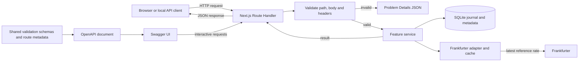

# HTTP API design: draft

**Status:** Endpoint names and payloads are proposals for discussion; no application endpoint or OpenAPI document exists yet.

**Decision references:** [D-003](DECISIONS.md#d-003), [D-007](DECISIONS.md#d-007), [D-008](DECISIONS.md#d-008), [D-010](DECISIONS.md#d-010), [D-017](DECISIONS.md#d-017), [D-018](DECISIONS.md#d-018), and [D-019](DECISIONS.md#d-019). Detailed requirements and tasks: [PRD-10](prd/PRD-10-api.md) and [Tasks 10](tasks/TASKS-10.md).

## Agreed direction

- Use Next.js App Router Route Handlers, an OpenAPI specification, and Swagger UI.
- Reuse validation schemas for documentation where practical, and test that the published specification and implemented behavior remain aligned. The generator is not selected yet.
- Document baseline errors as Problem Details: 400 invalid request, 404 missing resource, 409 balance/quote/idempotency conflict, and 503 when no eligible exchange rate is available.
- Run locally without application authentication. The HTTP API and Swagger UI can change simulated data, so bind the host-facing development port to localhost unless access requirements are deliberately changed.
- Expose existing wallet operations, not real payment or banking integrations. Destination accounts are inspect-only; enforce that in server-side services as well as in the UI.

## Candidate endpoint groups

| Method | Example route | Purpose |
| --- | --- | --- |
| GET | `/api/accounts` | List the main account and simulated destinations for the switcher. |
| GET | `/api/accounts/{accountId}/wallets` | Inspect an account's currency balances. |
| POST | `/api/wallets` | Add a supported fiat wallet to the main account. |
| PATCH | `/api/accounts/{accountId}/default-currency` | Change the main account's default currency; destinations are read-only. |
| GET | `/api/currencies` | List available fiat currencies. |
| POST | `/api/deposits` | Simulate a deposit with a selected provider. |
| POST | `/api/withdrawals` | Simulate a withdrawal with a selected provider. |
| POST | `/api/quotes` | Preview an FX conversion or cross-currency transfer with a one-minute quote. |
| POST | `/api/conversions` | Confirm a conversion, creating the target wallet if required. |
| POST | `/api/transfers` | Transfer to an existing or newly created simulated account. |
| GET | `/api/transactions` | List/filter an account's transactions. |
| GET | `/api/transactions/{transactionId}` | Inspect an individual transaction. |

These examples are not a finalized route contract. Decide account-default updates, exact quote shapes, pagination, and resource names before implementation.

## Proposed request/response contract

The names, fields, example IDs, successful response statuses, and payloads in this section are **illustrative proposals**, not an existing or finalized API. The error baseline and idempotency requirements are the agreed [D-017](DECISIONS.md#d-017)/[D-019](DECISIONS.md#d-019). Each route must be reflected in the generated OpenAPI document and tested against its actual implementation.

| Operation | Candidate input | Candidate successful result | Relevant decisions |
| --- | --- | --- | --- |
| List accounts | No body | Account IDs, default currencies, main/destination designation, and inspect-only indication | [D-003](DECISIONS.md#d-003), [D-004](DECISIONS.md#d-004) |
| Inspect wallets | `accountId` path parameter | Wallet IDs, fiat codes, exact balances, and any applicable USD-total/unavailable indication | [D-003](DECISIONS.md#d-003), [D-011](DECISIONS.md#d-011), [O-004](DECISIONS.md#o-004) |
| Add wallet | Main `accountId` and supported fiat code | Created wallet ID and zero journal-derived balance | [D-004](DECISIONS.md#d-004), [D-018](DECISIONS.md#d-018) |
| Change main default | Main `accountId` plus fiat code | Updated default; missing-wallet behavior remains open | [D-004](DECISIONS.md#d-004), [O-004](DECISIONS.md#o-004) |
| List currencies | No body | Supported fiat codes/names; offline-catalog policy remains open | [D-004](DECISIONS.md#d-004), [O-005](DECISIONS.md#o-005) |
| Deposit / withdrawal | Main wallet ID, decimal-string amount, fictional provider, `Idempotency-Key` | Completed transaction and affected balance | [D-005](DECISIONS.md#d-005), [D-006](DECISIONS.md#d-006), [D-019](DECISIONS.md#d-019) |
| FX quote | Operation kind, source wallet, amount, target currency, and destination context when needed | Server-owned quote reference, displayed amounts, rate, source date, fetched/cached state, expiry | [D-007](DECISIONS.md#d-007), [D-008](DECISIONS.md#d-008) |
| Convert | Server quote reference and `Idempotency-Key` | One completed conversion, debit/credit amounts, and retained rate metadata | [D-009](DECISIONS.md#d-009), [D-018](DECISIONS.md#d-018), [D-019](DECISIONS.md#d-019) |
| Transfer | Source wallet, destination account ID, amount, target/default-currency information, quote reference when FX is needed, and `Idempotency-Key` | One completed transfer and destination identity; the credited wallet/account is created when needed | [D-010](DECISIONS.md#d-010), [D-018](DECISIONS.md#d-018), [D-019](DECISIONS.md#d-019) |
| Transaction list | Account ID and optional type, currency, date filters | Completed records, newest first; pagination is open | [D-012](DECISIONS.md#d-012), [O-003](DECISIONS.md#o-003) |
| Transaction detail | Transaction ID and, if needed, inspected account context | Stored operation details, including provider/destination and historical rate as applicable | [D-012](DECISIONS.md#d-012), [O-003](DECISIONS.md#o-003) |

Illustrative deposit request; the provider code and path are proposals:

```http
POST /api/deposits
Content-Type: application/json
Idempotency-Key: example-request-001

{
  "walletId": "example-usd-wallet",
  "amount": "100.00",
  "provider": "DEMO_BANK"
}
```

Illustrative FX preview; the rate is fictional and the field names are not final:

```json
{
  "quoteId": "example-quote",
  "source": { "amount": "100.00", "currency": "USD" },
  "target": { "amount": "80.00", "currency": "GBP" },
  "rate": "0.8",
  "rateDate": "2026-11-10",
  "fetchedAt": "2026-11-11T10:00:00Z",
  "cached": false,
  "expiresAt": "2026-11-11T10:01:00Z"
}
```

The server must bind the quote to the operation and verify it at confirmation; the client must not be able to change the rate or amount while reusing the quote. For a same-currency transfer no FX quote is needed. Successful confirmation must record the exact terms used, not recalculate historical details from a newer rate.

## Proposed API contract flow



The diagram is a proposed contract, not an implemented API. See [DIAGRAMS.md](DIAGRAMS.md) for the quote, transfer, accounting, and idempotency flows.

## Proposed request and response practices

- Send monetary amounts as decimal strings, such as `"100.00"`, rather than JSON floating-point numbers. Validate currency-specific precision and numeric bounds on the server.
- Use server-created quotes; a confirmation refers to its quote rather than supplying a trusted exchange rate. If it expires after one minute, refresh and reconfirm. Store the applied rate, source date, fetch timestamp, and cached/fresh status.
- Return standard HTTP Problem Details (`application/problem+json`) with a machine-readable code. Use the baseline 400/404/409/503 statuses in D-017; define exact error types and payloads. Rejected operations are not recorded in transaction history.
- Require `Idempotency-Key` for money-moving requests. An accepted key and matching input replay the original definitive success or error; reuse with different input is rejected. Store failed-result metadata separately from completed history. If the result is unknown, retry with the same key; after a definite error, use a new key for a new intentional attempt. See [IDEMPOTENCY.md](IDEMPOTENCY.md).
- Document that Swagger's interactive requests operate on the same simulated wallet data, and use isolated databases for automated tests.

### Example error envelope

Illustrative Problem Details response for an insufficient-funds conflict; exact type URIs and field names remain open:

```http
HTTP/1.1 409 Conflict
Content-Type: application/problem+json

{
  "type": "about:blank",
  "title": "Conflict",
  "status": 409,
  "detail": "The selected wallet has insufficient funds.",
  "code": "INSUFFICIENT_FUNDS"
}
```

Do not expose internal SQLite errors or stack traces to the client. Exact error types and idempotency storage/recovery details are tracked in [O-003](DECISIONS.md#o-003) and [O-006](DECISIONS.md#o-006).
