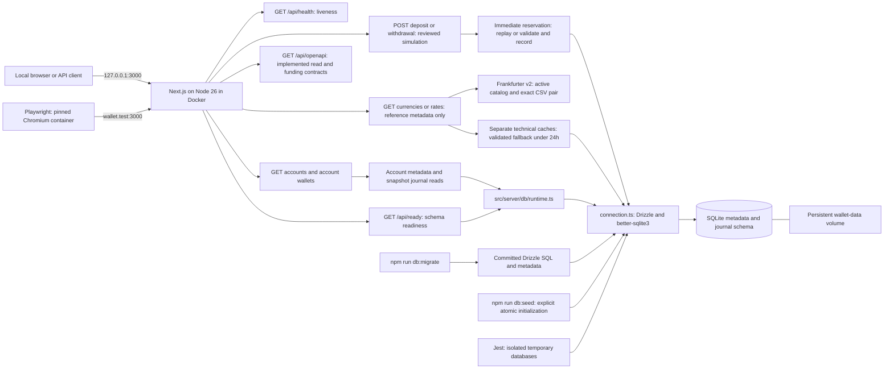
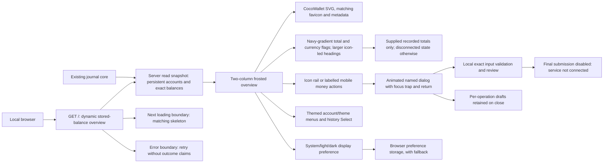
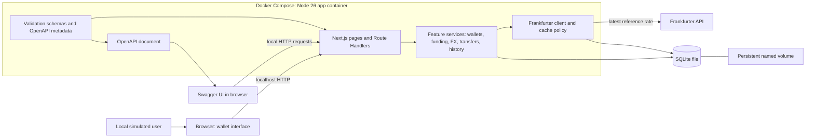
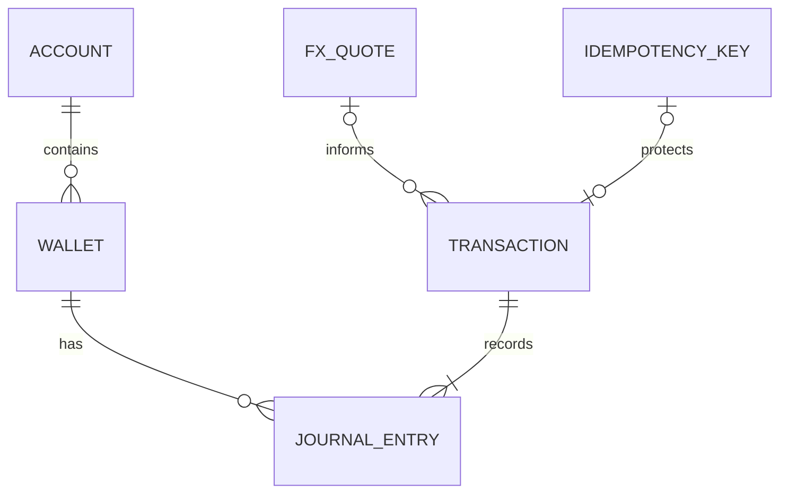
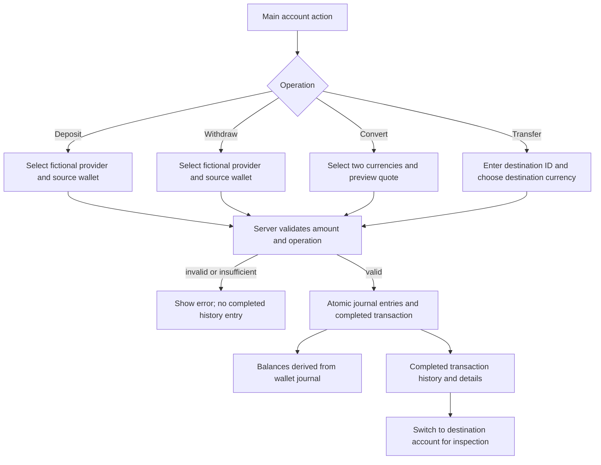
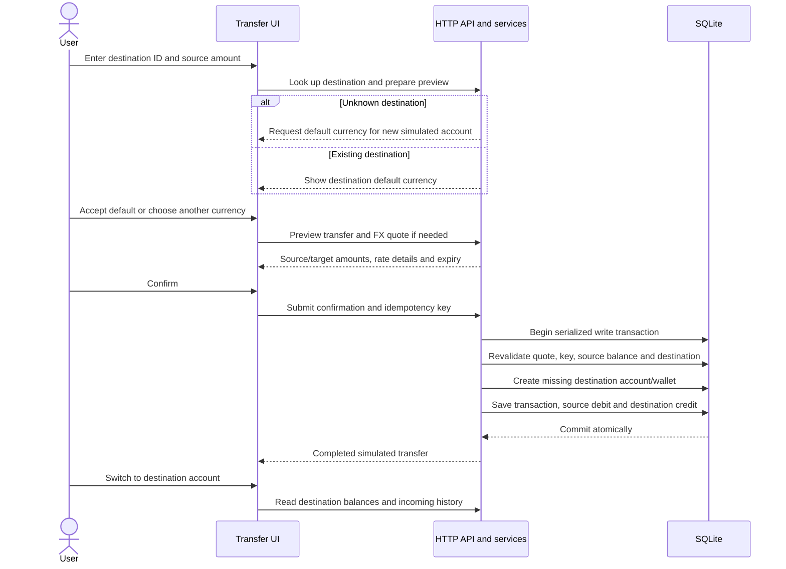

# Architecture and flow diagrams

**Status:** Persistent reads/funding/conversion, fresh-first reference metadata and immutable quotes are implemented. Conversion has reviewed fixed terms, expiry/reconfirmation, documented submission and shared original-key recovery. Transfers, full history/valuation and Swagger remain future features. The [decision register](DECISIONS.md) is authoritative when a diagram and an open question conflict.

T07-01 also implements the internal atomic conversion service: global
funding/conversion key ownership, retained original results and atomic target
creation/journal/quote use. T07-02 connects the conversion endpoint and confirmation
UI; transfer submission stays disabled. See [CONVERSIONS.md](CONVERSIONS.md).

## Implemented foundation flow



The application database contains one explicitly initialized main account and
three startup wallets; no transactions or journal entries were seeded. Ordinary
unit/integration tests use isolated databases and cannot use the runtime connection.
The following sections distinguish implemented reads from future financial writes.

## Implemented interface-first boundary

Tasks: [T11-02](tasks/TASKS-11.md#t11-02), [T11-04](tasks/TASKS-11.md#t11-04), [T11-06](tasks/TASKS-11.md#t11-06), [T11-07](tasks/TASKS-11.md#t11-07). Contract and limitations:
[UI_FOUNDATION.md](UI_FOUNDATION.md).



GET reads never seed wallet data, invent a rate/history or send financial writes.
Destination fixtures verify service-level account isolation/inspect-only behavior;
creating destinations through HTTP transfers remains future work.

## System and Docker boundary

Decisions: [D-001](DECISIONS.md#d-001), [D-002](DECISIONS.md#d-002), [D-007](DECISIONS.md#d-007), [D-017](DECISIONS.md#d-017), [D-020](DECISIONS.md#d-020). Tasks: [T01-01](tasks/TASKS-01.md#t01-01), [T01-03](tasks/TASKS-01.md#t01-03), [T10-03](tasks/TASKS-10.md#t10-03).



SQLite is an embedded file, not a separate database server. The application is local and has no authentication; the host-facing port should be bound appropriately, e.g. localhost. The named volume must survive normal container recreation. Explicit volume deletion can delete the wallet data; backups need an agreed procedure.

## Logical data relationships

Decisions: [D-003](DECISIONS.md#d-003), [D-004](DECISIONS.md#d-004), [D-008](DECISIONS.md#d-008), [D-012](DECISIONS.md#d-012), [D-018](DECISIONS.md#d-018), [D-019](DECISIONS.md#d-019). Tasks: [T02-02](tasks/TASKS-02.md#t02-02), [T03-01](tasks/TASKS-03.md#t03-01), [T09-01](tasks/TASKS-09.md#t09-01), [T10-02](tasks/TASKS-10.md#t10-02).



Account, wallet, transaction, journal, funding-outcome and immutable quote/use
tables now exist. This conceptual diagram omits technical metadata: `fx_quotes`
references source account/wallet; `fx_quote_uses` uniquely links one quote and one
successful transaction. A wallet is unique by account and currency. Deposits or
withdrawals affect one wallet; conversions/transfers have two entries in their
respective currencies, which must **not** be summed together. Triggers protect
history, identities, used precision and quote/use retention. Full cardinality
and balance checks belong to the application write boundary, not arbitrary SQL.
A quote is needed only for FX. Definitive failures stay outside completed history;
see [FUNDING.md](FUNDING.md) and [QUOTES.md](QUOTES.md).

Implemented balance reads:

```mermaid
flowchart LR
    Reader[Wallet or account read] --> Snapshot[SQLite read transaction]
    Snapshot --> Identity[Check account/wallet and precision]
    Identity --> Stream[Stream each wallet's own signed entries]
    Stream --> Bigint[Arbitrary-precision bigint subtotal]
    Bigint --> Bounds[Validate final balance 0..M]
    Bounds --> Result[Return bigint minor units]
    Result --> Text[Future HTTP layer: format decimal strings]
```



Account wallet metadata and balances share one snapshot. No balance column,
SQL `SUM()`, floating-point aggregate, or cross-currency addition is used.

## Business operations and history

Decisions: [D-003](DECISIONS.md#d-003), [D-005](DECISIONS.md#d-005), [D-006](DECISIONS.md#d-006), [D-009](DECISIONS.md#d-009), [D-010](DECISIONS.md#d-010), [D-012](DECISIONS.md#d-012).



No action moves real money. Destination accounts can be inspected but cannot initiate operations. A transfer to the main account's own ID is rejected; conversions handle the main account's currency changes.

## Rate, cache, and quote sequence

Decisions: [D-007](DECISIONS.md#d-007), [D-008](DECISIONS.md#d-008), [D-018](DECISIONS.md#d-018), [D-023](DECISIONS.md#d-023), [D-032](DECISIONS.md#d-032). Tasks: [T06-01](tasks/TASKS-06.md#t06-01), [T06-02](tasks/TASKS-06.md#t06-02).

```mermaid
sequenceDiagram
    actor User
    participant UI as Browser
    participant API as Quote handler/service
    participant FX as Frankfurter
    participant Cache as SQLite rate cache
    participant DB as SQLite immutable quotes
    User->>UI: Enter source, target and amount
    UI->>API: Request preview
    API->>API: Validate currency pair and amount
    API->>FX: Fetch latest available reference rate
    alt Rate available
        FX-->>API: Rate and source date
        API->>Cache: Record exact pair and fetch time
    else API unavailable or pair unavailable
        API->>Cache: Look for exact pair fetched within 24 hours
        alt Eligible cached rate exists
            Cache-->>API: Rate, source date and fetch time
            API->>API: Mark preview as cached
        else No eligible cached rate
            API-->>UI: 503 Problem Details; no operation
        end
    end
    API->>DB: Begin immediate reservation after network work
    API->>API: Revalidate context, funds and cache eligibility at issuance
    API->>DB: Persist immutable rounded terms with a full 60-second hold
    DB-->>API: Commit preview, no funds reserved or moved
    API-->>UI: Preview amount, rate, source date, cache status and expiry
    Note over UI,API: Conversion review/confirmation is connected; transfer submission remains T08
```

The API may return a prior reference **source date** even when a rate was fetched
just now. Cache eligibility is checked at issuance; an issued quote retains its
full minute if the cache later crosses 24 hours. Readback never fetches or extends
terms. Internal confirmation rechecks exact input/context/funds, and a scoped
after-record step atomically registers at most one successful use. Failed attempts
do not consume it. See [QUOTES.md](QUOTES.md). Convert explicitly requests terms,
then confirms them through `POST /api/conversions`; expiry requires a new preview
and renewed confirmation. Unresolved recovery never refreshes its original quote.

## Code flow for a completed money operation

Decisions: [D-006](DECISIONS.md#d-006), [D-017](DECISIONS.md#d-017), [D-018](DECISIONS.md#d-018), [D-019](DECISIONS.md#d-019). Tasks: [T02-03](tasks/TASKS-02.md#t02-03), [T10-01](tasks/TASKS-10.md#t10-01), [T10-02](tasks/TASKS-10.md#t10-02).

```mermaid
sequenceDiagram
    participant UI as Browser or Swagger
    participant API as Route Handler
    participant Service as Feature service
    participant DB as SQLite
    UI->>API: POST request plus Idempotency-Key
    API->>API: Parse and validate request
    API->>Service: Execute validated operation
    Service->>DB: Preflight lookup of key and request fingerprint
    alt Previously recorded matching result
        DB-->>Service: Original definitive success or error
        Service-->>API: Replay result; no new entries
    else Key reused with different input
        Service-->>API: Conflict; no new entries
    else New operation
        Note over Service: Prepare any FX quote before the write transaction
        Service->>DB: Begin serialized write transaction
        Service->>DB: Recheck key, quote and journal-derived balance
        alt Another matching request already completed
            DB-->>Service: Original definitive result
            Service-->>API: Replay result; no new entries
        else Valid new operation
            Service->>DB: Create any missing destination/wallet
            Service->>DB: Insert transaction and journal entry or entries
            Service->>DB: Atomically record success result and key
            DB-->>Service: Commit
            Service-->>API: Completed result
        else Definitive business error for an accepted key
            Service->>DB: Preserve error result/key without completed history
            DB-->>Service: Persist technical result
            Service-->>API: Original error
        end
    end
    API-->>UI: JSON result or Problem Details
```

The implemented boundary acquires `BEGIN IMMEDIATE` before its synchronous
callback and commits/rolls back creation, transactions, entries and technical
success together. Escaped scopes and promise callbacks are rejected. Funding
already implements durable original outcomes under D-030. Quote use joins the
journal failure latch even if its error is caught inside the after-record hook.
Conversion now implements these rules through the endpoint and shared recovery UI;
the internal transfer service also implements atomic creation/accounting/results,
but transfer HTTP/UI integration is future work. Replay an existing
result before quote expiry/use checks, then recheck the key under the reservation.
Do not hold it during network work. See [JOURNAL.md](JOURNAL.md) and
[QUOTES.md](QUOTES.md).

## Cross-currency transfer sequence

Decisions: [D-003](DECISIONS.md#d-003), [D-008](DECISIONS.md#d-008), [D-010](DECISIONS.md#d-010), [D-018](DECISIONS.md#d-018), [D-019](DECISIONS.md#d-019). Tasks: [T08-01](tasks/TASKS-08.md#t08-01), [T08-02](tasks/TASKS-08.md#t08-02).

The service-side atomic steps are implemented in [TRANSFERS.md](TRANSFERS.md).
This end-to-end UI/API journey remains proposed: no transfer route or confirmed
browser send exists. Actual service replay occurs before quote/funds checks,
then again under `BEGIN IMMEDIATE`; successful quote use and the original retained
receipt commit with recipient/wallet creation and both entries. Same-currency
service sends never request a rate; only missing default metadata may fetch the
catalog outside the writer. T09-01 history is required before T08-02 inspection.



If source and destination currencies match, no FX quote is needed. If the quote expires, is invalid, or funds are insufficient, no partial account, wallet, transaction, or journal entry is committed. The destination remains inspect-only.

## Illustrative accounting example

Assume the main USD wallet already has at least **100.00 USD**. A hypothetical reference rate of **1 USD = 0.80 GBP** is shown and confirmed within the quote window. A completed transfer records one transaction and two entries:

| Wallet | Journal delta in minor units | Display delta |
| --- | ---: | ---: |
| Main USD wallet | `-10000` | `-100.00 USD` |
| Destination GBP wallet | `+8000` | `+80.00 GBP` |

The example rate is fictional. The journal is the balance source; each wallet's balance is the sum of its **own** entries. Test exact arithmetic, half-up conversion rounding, duplicate requests, and concurrent attempts to spend the same balance.
