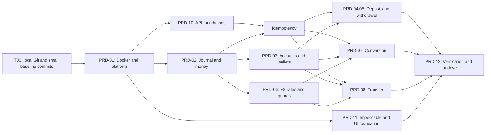

# Proposed implementation plan

**Status:** Draft; sequencing and scope depend on the answers in the PRD. No application implementation has started. Individual tasks and live statuses are in [KANBAN.md](KANBAN.md); [PRD.md](PRD.md) links each task group to its source feature PRD and decisions. Follow the Angular-style, one-intention-per-commit rule in [D-021](DECISIONS.md#d-021) and Git setup in [D-022](DECISIONS.md#d-022). See [READINESS.md](READINESS.md) for outstanding setup and feature-stage checks.

## Tasks

1. **Finalize scope and design direction** — Review the coding guide and proposed API, then initialize the installed Impeccable skill with product context before design. Update the PRD and decision log.
2. **Set up the application** — Create the Next.js/Node 26/TypeScript project with npm and a Docker-first workflow; configure shadcn/ui, Lucide, ESLint, Prettier, tests, OpenAPI/Swagger, and environment documentation. Persist the SQLite file in a named volume.
3. **Build the persistence foundation** — Configure and verify `better-sqlite3` with Node 26 inside the container; define the SQLite schema, migrations and seed data; derive balances from journal entries and implement exact money handling, half-up rounding, balance invariants, and transaction-safe writes.
4. **Wallets and balance views** — Seed the main account with zero-balance USD, EUR and GBP, with USD as its initial, changeable default; allow adding supported fiat wallets; implement an account switcher with inspect-only destination views, per-wallet balances, and an approximate USD total that becomes unavailable when a required rate is missing.
5. **Simulated deposits and withdrawals** — Add the three fictional provider labels, input validation, immediate no-fee balance updates, durable transaction records, and error handling.
6. **Frankfurter conversions** — Integrate latest reference rates and dates, the 24-hour cached fallback, one-minute quote confirmation, currency-aware rounding, atomic debit/credit, automatic target-wallet creation, and recorded rate metadata. Block when neither the API nor an eligible cached rate can supply the pair.
7. **Transfers** — For an unknown entered ID, choose its default currency and create and credit a simulated destination account; debit the source and record the transfer. Default to its default currency, permit another destination currency, automatically create a missing wallet, and convert when needed. Reject the sender's own account ID.
8. **Transaction history and details** — Show completed operations newest first, with standard details and type, currency, and date filters; show transfers as outgoing for the main account and incoming for the destination. Rejected attempts are not recorded.
9. **Design refinement and quality** — Apply the agreed Impeccable design workflow, address accessibility and responsive states, add Jest unit/integration tests and Playwright browser tests, and update handover documentation.

Tasks 5–8 depend on the persistence foundation. Their exact ordering can change after product decisions.

## Dependency overview



See individual task files for exact dependencies; this diagram is a high-level planning view and does not imply the features have been implemented.

## Suggested completion criteria

- **Setup:** The Docker-based Node 26 app, npm install, local startup, database migration, and test commands are documented and work together; wallet data persists across container recreation.
- **Persistence:** Each account has at most one wallet per currency; balances are derived from journal entries, and entries, transaction records, and any destination creation succeed or roll back together.
- **Wallets:** The main account starts with three zero balances; supported fiat wallets can be added; the switcher provides inspect-only destination views and a clearly approximate USD total.
- **Deposits and withdrawals:** The three provider labels work as simulations; accepted operations update balances and history, and invalid or unaffordable amounts are rejected.
- **Conversions:** Preview and confirmation use the same eligible rate, including its date and any cached indication; expiration, rate unavailability, rounding, and insufficient funds are handled without incorrect balance changes.
- **Transfers:** A new ID creates a switchable simulated account, cross-currency transfers use the confirmed rate, missing destination wallets are created, and a transfer to the main account's own ID is rejected.
- **History:** Main and inspected destination accounts expose the agreed transaction information, including details and basic filters.
- **API:** Swagger UI and its OpenAPI document describe the implemented endpoints accurately and are exercised by tests.
- **Finish:** Light/dark themes, icon-library licensing, reduced-motion support, responsive layouts, and the agreed Impeccable workflow are checked and documented.

## Proposed core transaction shape

This is **pseudocode**, not implemented or executable code. Exact modules and schema will be documented in the handover after implementation.

```text
# Preview phase for a new intent: outside any database write transaction.
preview = prepareServerSidePreview(source, destination, amount)
confirm(preview)  # require a new confirmation if its FX quote expires after 1 minute

# Confirmation/retry phase: reuse the original key, input, and quote reference.
returnRecordedResultIfPresent(requestId, requestFingerprint)  # before fresh FX or expiry checks

databaseTransactionWithSerializedWrites:
    recheckRecordedResultAndFingerprint(requestId)
    validateServerSidePreviewAndQuoteIfNeeded(preview)
    rejectOwnAccountIdOrInvalidAmount()
    createDestinationAccountAndWalletIfMissing()
    assertJournalBalanceCoversDebit()  # check under the write lock
    saveTransfer(requestId, preview.rateMetadata)
    appendDebitAndCreditEntries()

onDefinitiveFailureForAcceptedKey:
    retainReplayableErrorWithoutCompletedHistory()
```

The quote must be server-validated rather than trusting a client-supplied rate. Any failed validation, debit, credit, or record insertion must leave all balances and newly created destination data unchanged. Currency amounts and rates need exact arithmetic and explicitly defined rounding; never rely on floating-point arithmetic for balances.

## Cross-cutting checks

- Exercise successful and rejected operations, including insufficient funds and zero/negative or overly precise inputs.
- Test concurrency and duplicate submissions so a balance cannot be spent twice or an operation unintentionally applied twice.
- Verify conversion arithmetic and the retained rate/date, including rounding and unavailable or stale rate scenarios.
- Confirm balance changes and transaction records commit or roll back together.
- Confirm data and history survive application restarts on the intended deployment.
- Test keyboard access, mobile layouts, loading/empty/error states, and individual transaction details.
