# CocoWallet user guide

CocoWallet is a **local wallet simulation**. It lets you explore balances, deposits, withdrawals, conversions, transfers, and completed transaction history. No real funds move, and there is no bank, blockchain, or authentication integration.

This guide follows the interface from opening the app to finding a completed transaction. The screenshots were captured with Playwright against a **separate disposable database** and deterministic reference-rate fixtures. Amounts and account IDs in them are examples, not your wallet data.

The captures were made with `scripts/capture-project-guide.cjs` against a disposable Docker container using `/tmp/opencode/funding-e2e.sqlite` and `scripts/e2e-reference-provider.mjs`; they do not depict the persistent wallet or live exchange rates.

## 1. Start the application

You need Docker Engine and Docker Compose. From the project root, run:

```sh
docker compose build app
docker compose run --rm app npm ci
docker compose run --rm app npm run db:migrate
docker compose run --rm app npm run db:seed
docker compose up -d app
```

Open `http://localhost:3000/`. The health check is at `http://localhost:3000/api/health`. If port 3000 is already taken, use `APP_PORT=3100 docker compose up -d app` and open port 3100 instead.

Migrations and the seed are explicit setup steps. The seed creates the main account and initial currency wallets, **not funds or transactions**. The database lives in the `wallet-data` Docker volume. For normal shutdown use `docker compose down` without `--volumes`; deleting that volume destroys the simulated balances and history. The application has no login and must not be exposed publicly.

## 2. Get oriented


The **Overview** shows an approximate USD total, actions, recent completed activity, and individual currency wallets. The total uses reference rates for nonzero foreign-currency balances; if a required rate is unavailable the total can be unavailable while individual balances remain visible. **Currency rates** explains the rate provenance when applicable. The small balance chart shows actual recorded observations, not a made-up trend.

Use the side navigation for **Overview** and **History**. On a narrow screen, use the labelled bottom navigation and **Actions** menu. The account menu lets you inspect a destination account; that is not a login, and destination accounts cannot initiate money operations. Use the theme menu for System, Light, or Dark. The balance card's privacy control hides monetary and history details across the app.

## 3. View balance history on Overview

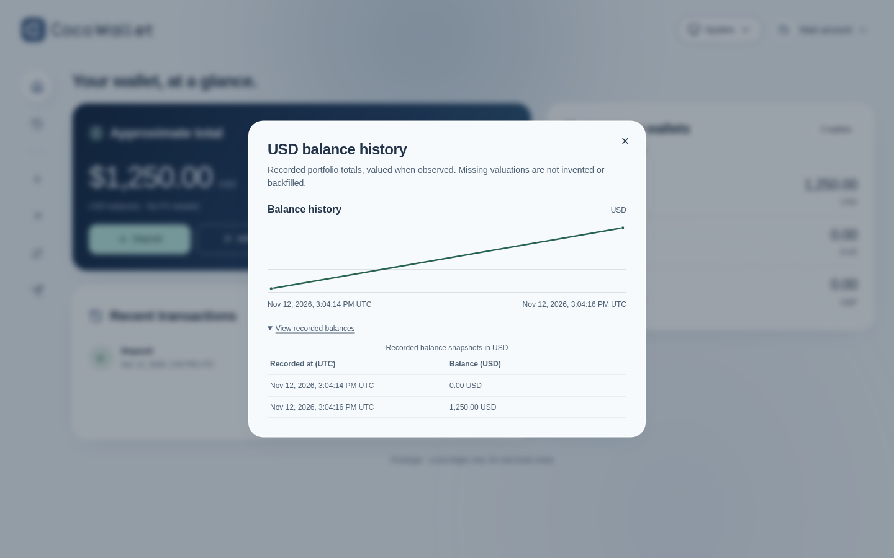

1. Select **Overview**, then use the account menu to choose the account whose history you want to inspect.
2. In the **Approximate total** card, select the small chart beside the USD amount. With a keyboard, focus **View recorded USD balance history** and press Enter or Space. This chart is on Overview; it is separate from the transaction **History** page.
3. The **USD balance history** dialog shows the selected account's recorded portfolio totals and their UTC dates. Each point is an observation valued when it was recorded; connecting lines do not mean the balance was tracked continuously. A single observation appears as a point rather than a trend.
4. Select **View recorded balances** below the chart to open a table of exact recorded USD amounts and times. If there are more than six records, use **Previous** and **Next** to page through the table; the chart continues to show the full recorded series.
5. Close the dialog with its close button or Escape to return to Overview.

If the card says **No history yet**, there are no recorded observations to open. **History unavailable** means the recorded data could not be used. If amounts are hidden, show them again using the Overview privacy control before opening the chart. The app does not invent missing historical values or reprice old observations using today's rates.

## 4. Deposit simulated funds

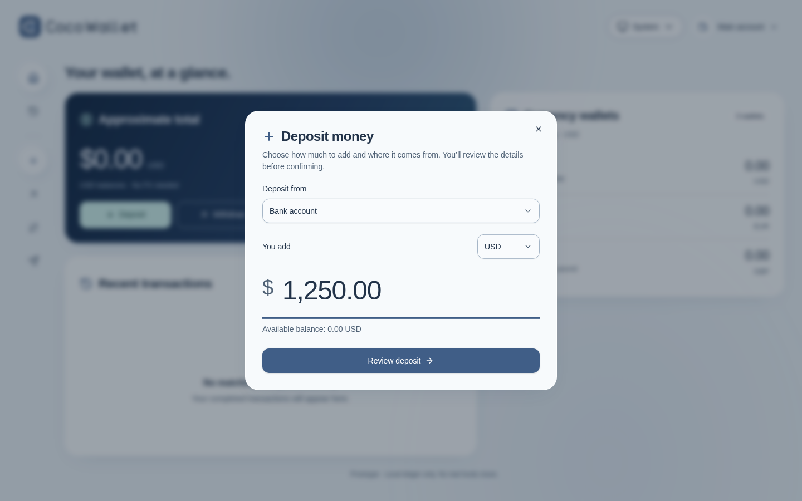

1. Select **Deposit** on Overview or from the mobile Actions menu.
2. Choose the wallet and fictional provider, then enter a positive amount with the allowed decimal precision.
3. Select **Review deposit**. Review alone does not change the balance.

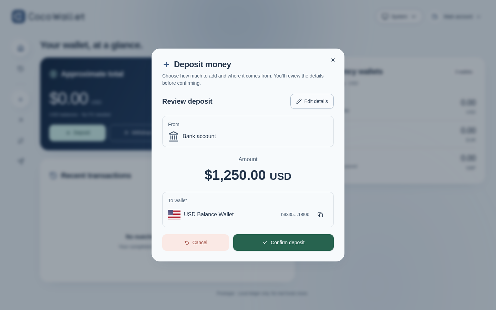

4. Check the provider, destination wallet, and exact amount. Select **Edit details** to go back, **Cancel** to leave without submitting, or **Confirm deposit** to submit.
5. Wait for the confirmed result. The confirmation includes a deliberate one-second server pause; loading is not success.

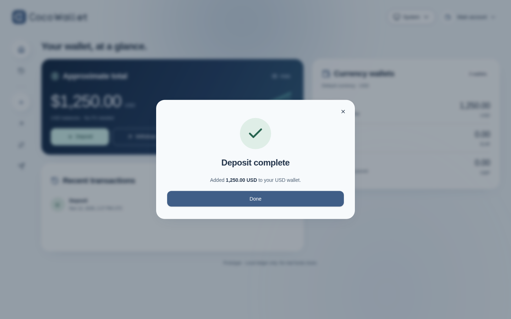

6. Select **Done**. The updated balance and completed activity appear on Overview. The screenshot illustrates a simulated deposit in the isolated documentation database.

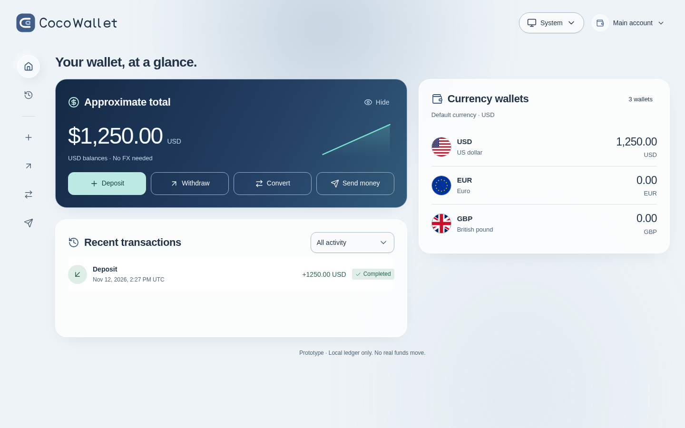

## 5. Withdraw from a wallet

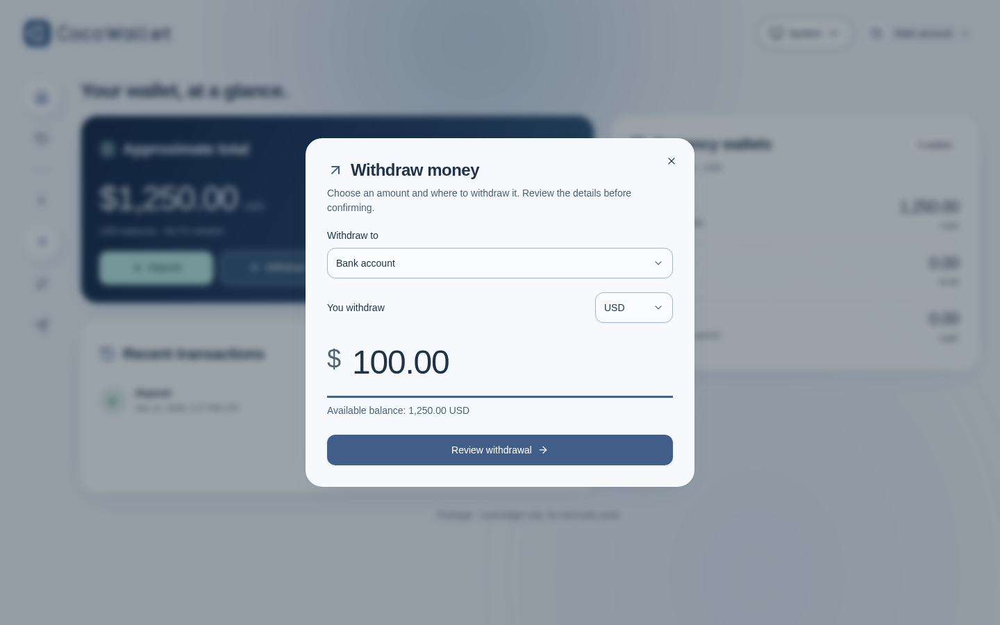

Select **Withdraw**, choose the wallet and fictional provider, and enter an amount no greater than its available balance. Select **Review withdrawal**, check the details, and confirm only if they are correct. An invalid amount or insufficient balance is reported rather than silently rounded or recorded as a completed transaction. Select **Done** after the confirmed result.

## 6. Convert between currencies

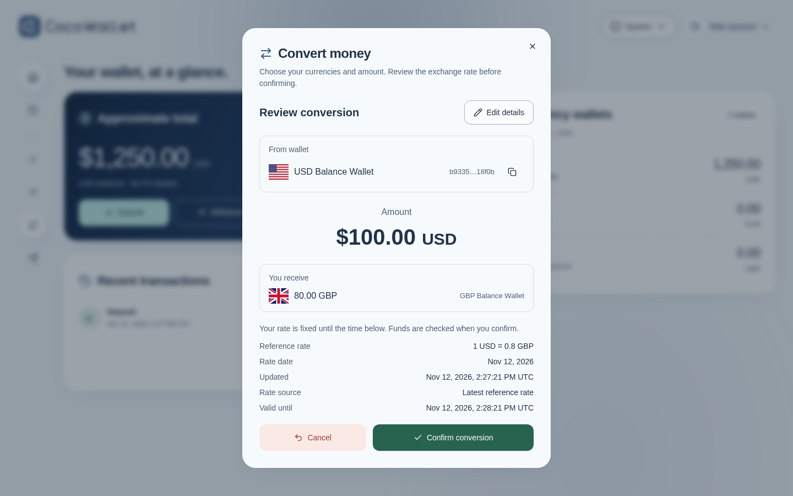

Select **Convert**. Choose an existing source wallet, enter the amount, and choose a different receiving currency; the interface offers USD, GBP, and EUR. Select **Review conversion** and inspect the exact source and target amounts, rate provenance, and expiry before confirming. The preview uses a server-owned reference-rate quote, not a streaming market rate, and does not reserve funds. If the quote expires, refresh it and review the new terms before confirming. If a required rate is unavailable, the app blocks the operation rather than inventing a rate.

## 7. Send to a simulated destination

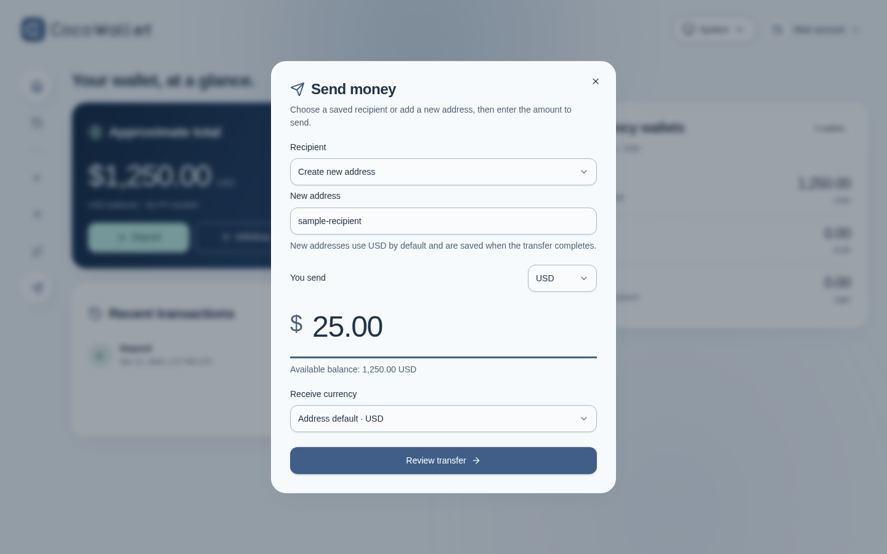

Select **Send money**. Choose a saved recipient or **Create new address**, enter the new destination ID, select the source and receiving currencies, and enter the amount. The interface supports USD, GBP, and EUR; a new destination defaults to USD. Review the exact recipient, currencies, and amount before confirming. A new destination is saved only after a successful transfer, not merely by opening or reviewing the form. Same-currency transfers need no FX quote; cross-currency transfers show quote terms. The main account's own ID is not a valid destination.

## 8. Switch to a read-only destination account

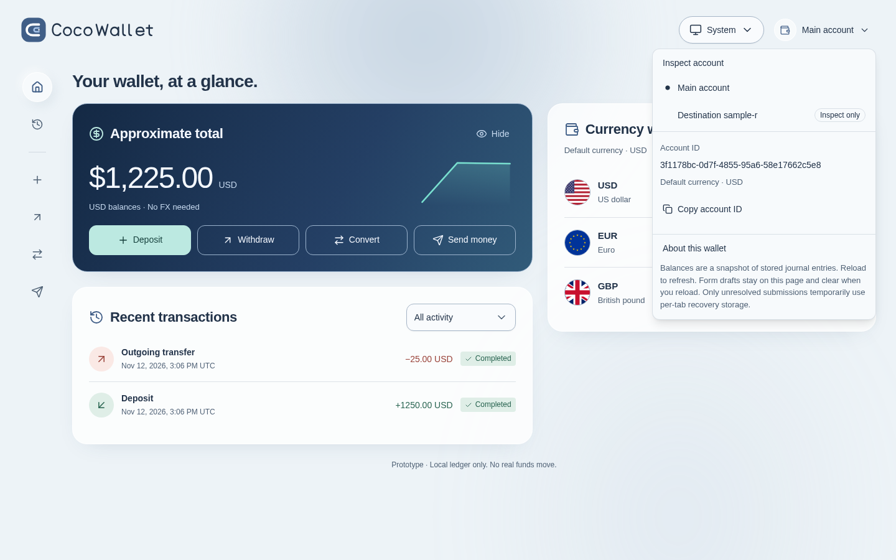

1. A destination appears in the account menu after a transfer to that address completes successfully. If you have not created one yet, follow **Send to a simulated destination** above; opening or reviewing a transfer alone does not create it.
2. On **Overview** or **History**, select the account control at the top right. It normally shows **Main account**; on a narrow screen it appears as a wallet icon. Its accessible name is **Account being inspected**.
3. Under **Inspect account**, select the destination marked **Inspect only**. Its menu label starts with **Destination** and the first eight characters of its address. The menu also shows the currently selected account's full ID and offers **Copy account ID**.

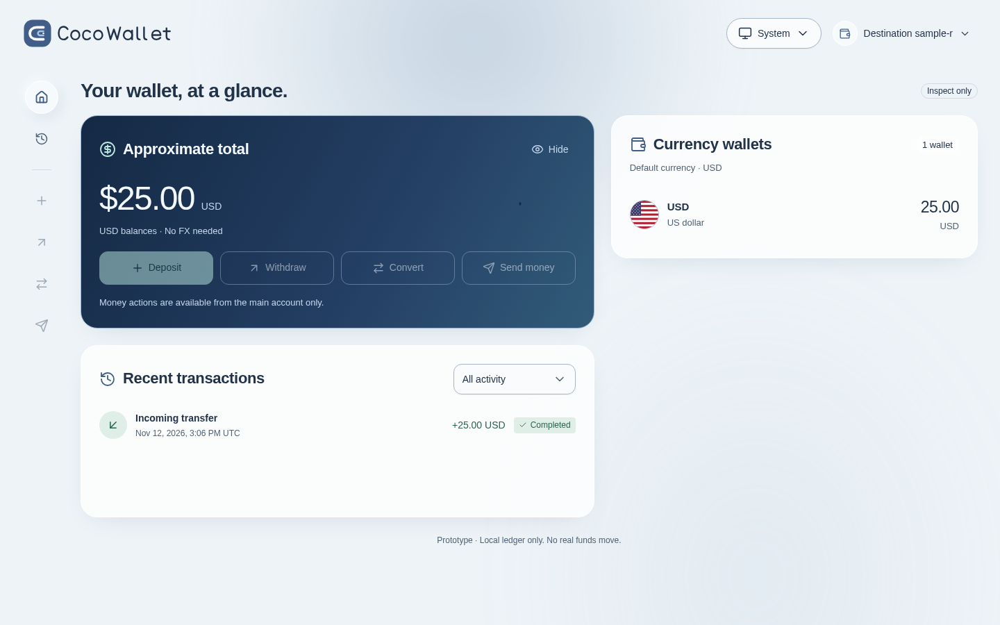

4. Overview now shows that destination's own wallet balances, approximate USD total, recorded balance chart when available, and recent completed activity. Open **History** to inspect its incoming transactions and their recorded details.
5. The destination is **read-only**: Deposit, Withdraw, Convert, and Send money are disabled while it is selected. It can still receive a transfer initiated from the main account. To make another money operation, open the account control again and select **Main account**.

Switching accounts only changes which account you inspect; it is not a login and does not itself move money. The selected account also scopes the History results and balance chart.

## 9. Browse and inspect history

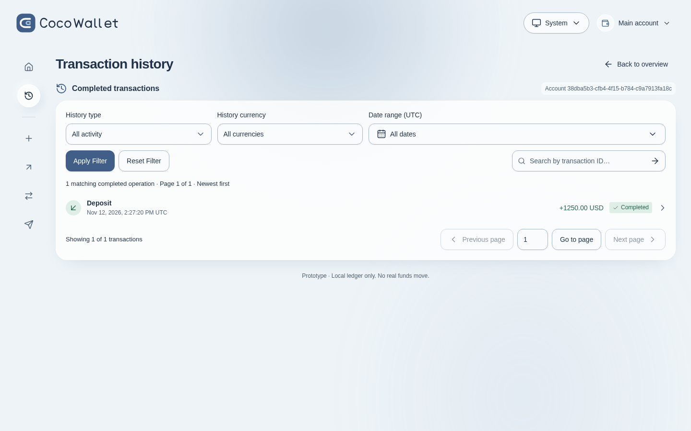

Select **History** in the navigation. The list shows completed transactions for the selected account, newest first. Change the type, currency, or inclusive UTC date range, then select **Apply Filter**. **Reset Filter** clears the filters and transaction search. The transaction-ID search is an exact ID filter: enter the complete ID and submit it with Enter or the arrow. It does not open a detail automatically. Use the paging controls when there are more results.

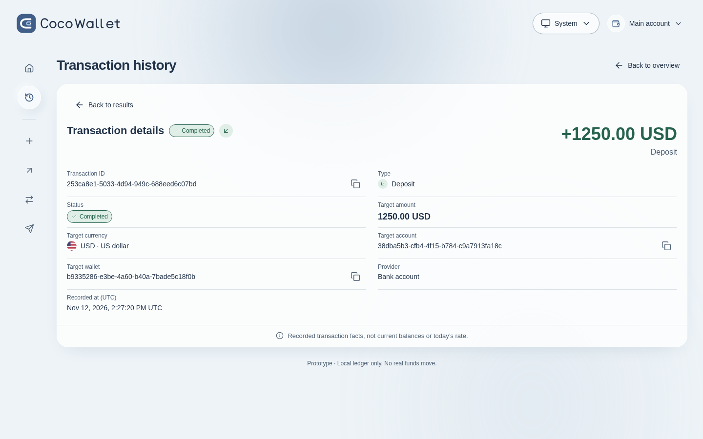

Select a row to see its immutable recorded facts, including its ID, time, amounts, and any applicable provider, destination, or recorded rate. Copy buttons copy individual IDs when clipboard access is available; otherwise use the offered manual-copy fallback. **Back to results** returns to the list. These facts are not current balances or today's rate.

## 10. Privacy, errors, and recovery

Use **Hide monetary amounts** on Overview to hide amounts and activity, including history details. Show them again from Overview before confirming a money operation.

If a submission's outcome is uncertain, do not create a replacement operation. Open **Review submission** and follow the recovery guidance to retry the original request. The application retains the original request and retry key in per-tab session storage while unresolved; clearing storage or closing the tab can lose that recovery context. If storage is blocked, the application prevents an unsafe submission. A confirmed result is shown only after the server returns a definitive receipt.

An ordinary new opening of a money dialog resets its amount to zero; **Edit details** within the same open dialog preserves the entered amount. Refer to the existing feature documents in `artifact/` for the accounting and recovery contracts.

## 11. Mobile layout

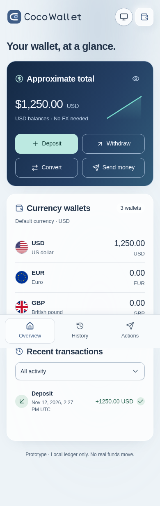

The content stacks on a narrow screen. The bottom bar provides **Overview**, **History**, and **Actions**; use Actions to open Deposit, Withdraw, Convert, or Send money. Forms and transaction details scroll when necessary.

## 12. More information

- `README.md` contains the current setup, verification commands, and operational cautions.
- `artifact/MONEY.md`, `artifact/JOURNAL.md`, and the feature documents describe exact accounting and implementation boundaries.
- `artifact/PROJECT_STRUCTURE.md` inventories project files; `artifact/TEST_CASES.md` lists discovered test cases.
